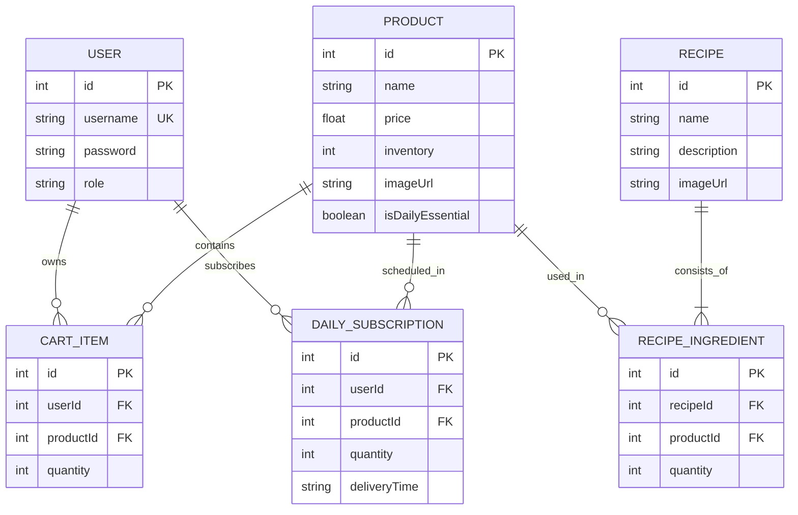
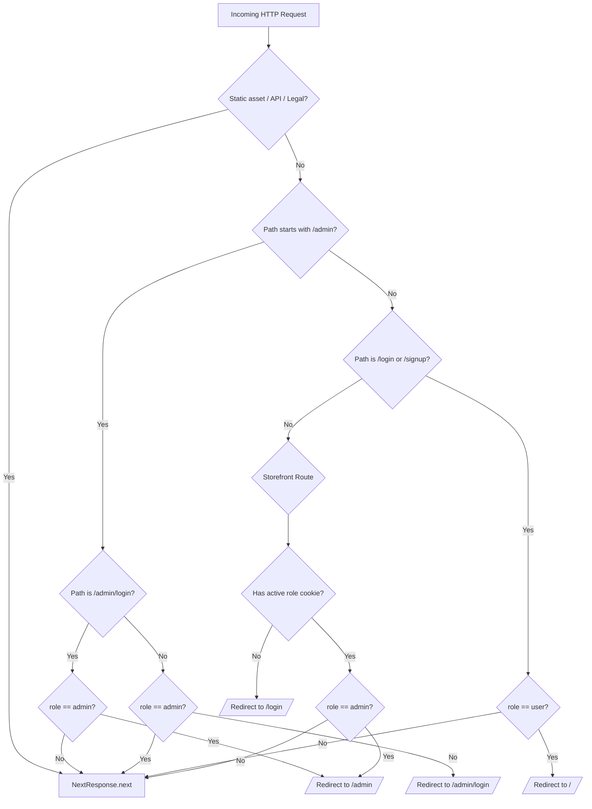
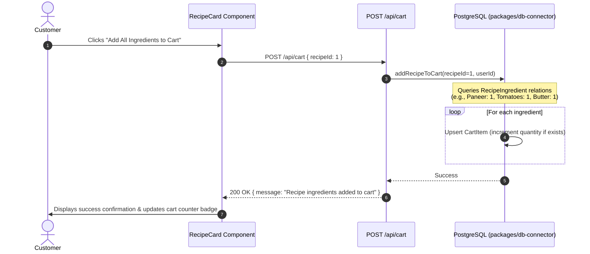
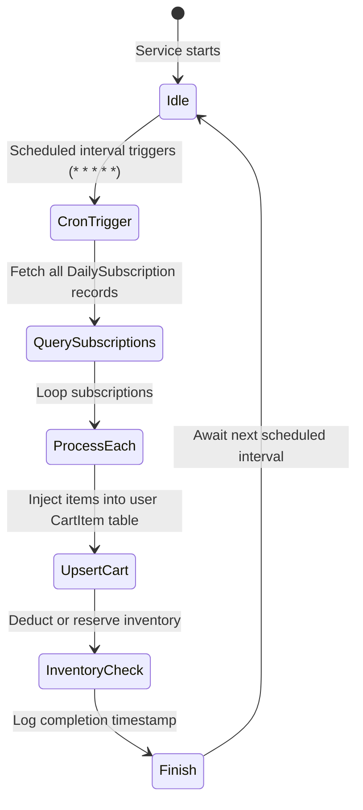

# Full Stack Architecture & End-to-End Workflow Guide

## 1. Executive System Overview

The **Grocery Auto-Order Platform** (Blinkit-style POC) is an end-to-end quick-commerce web application with autonomous subscription processing. Unlike conventional e-commerce platforms where customers manually reorder staple goods, this architecture combines:
1. **On-Demand Storefront**: Fast catalog browsing, meal kits with ingredient explosion into individual cart items, and live location detection.
2. **Autonomous Daily Morning Subscriptions**: Daily essential recurring subscriptions (e.g., milk, bread, eggs) processed automatically into orders by a dedicated background scheduler.
3. **Admin Inventory Console**: Real-time SKU inventory tracking, stock adjustments, recipe composition, and low-inventory telemetry.

---

## 2. Monorepo Workspace Topology

The repository is organized as an integrated monorepo utilizing npm workspaces:

```
grocery-poc/
├── apps/
│   ├── web/                     # Next.js 16 App Router Frontend & API Routes
│   │   ├── src/
│   │   │   ├── app/             # Routes: Storefront, Admin, Auth, API
│   │   │   └── middleware.ts    # RBAC security barrier & route redirection
│   │   └── .env                 # Web environment configuration
│   └── background-service/      # In-process scheduled recurring order worker
│       ├── src/index.ts         # Cron order generator
│       └── Dockerfile           # Standalone service container definition
├── packages/
│   └── db-connector/            # Shared Prisma ORM client & business logic
│       ├── prisma/
│       │   ├── schema.prisma    # PostgreSQL database schema
│       │   └── seed.ts          # Database seed definitions
│       └── src/index.ts         # Centralized queries and mutations
├── docs/                        # Architecture and reference specifications
├── scripts/                     # Verification test suite & migration tools
└── docker-compose.yml           # Local multi-service orchestration
```

### Component Responsibility Matrix

| Package / App | Technology | Role |
| :--- | :--- | :--- |
| `apps/web` | Next.js 16, React 19, TypeScript | Server-Side Rendered (SSR) & Client components, REST API endpoints, user authentication. |
| `apps/background-service` | Node.js, `node-cron`, TypeScript | Independent background worker automatically executing daily recurring order fulfillment. |
| `packages/db-connector` | Prisma ORM, PostgreSQL | Single source of truth for database connections, transactions, and business query helpers. |

---

## 3. Database Architecture & Data Schema

The platform runs on **PostgreSQL** configured through Prisma ORM (`packages/db-connector/prisma/schema.prisma`).

### Relational Entity Model



### Models Explained

1. **`User`**: Holds customer and administrator accounts. Includes an authenticated `role` (`'user'` or `'admin'`).
2. **`Product`**: Represents grocery SKUs. Tracks live inventory levels, pricing, image paths, and a flag `isDailyEssential` denoting eligibility for morning recurring delivery.
3. **`Recipe` & `RecipeIngredient`**: Defines curated ready-to-cook meal kits. Instead of bundling as a single opaque SKU, a Recipe links directly to relational `Product` rows with specific quantities (e.g., Paneer Butter Masala kit binds 1x Paneer, 1x Butter, 1x Tomato, 1x Garam Masala).
4. **`CartItem`**: The user's live checkout basket.
5. **`DailySubscription`**: User recurring schedules specifying product, quantity, and scheduled morning delivery window (default `'07:00 AM'`).

---

## 4. Authentication, RBAC & Security Middleware

Authentication is built with HTTP-only, secure cookies inspected by Next.js `middleware.ts`.

### Cookie Tokens
- `userId`: Numeric identifier of the active user session.
- `username`: Display name of the active user.
- `role`: Role entitlement (`'user'` or `'admin'`).

### Middleware Access Control (`apps/web/src/middleware.ts`)



---

## 5. Frontend System Architecture & Key Components

The frontend is built with Next.js 16 App Router using React Server Components (RSC) for data fetching and lightweight Client Components for interactivity.

### Storefront Component Hierarchy

- **`Header.tsx`**: Sticky top navigation bar containing branding, dynamic cart badge counter, live LocationSelector dropdown, search shortcut, and navigation links.
- **`LocationSelector.tsx`**: Interactive modal supporting:
  - Browser Geolocation API (`navigator.geolocation.getCurrentPosition`).
  - Reverse geocoding through **LocationIQ API** to translate coordinates into real street addresses.
  - Custom address manual entry with instant local storage persistence (`localStorage.getItem('user_delivery_address')`).
  - Fast-pick saved address chips.
- **`HeroSection.tsx` & `HotBar.tsx`**: Fast visual banner and 10-minute instant delivery promise.
- **`CategoryNavigation.tsx` & `FeaturedCategories.tsx`**: Filter chips and departmental shortcuts.
- **`RecipeCard.tsx`**: Displays meal kit cards with ingredient breakdown and a one-click "Add Kit to Cart" button.
- **`GroceryCard.tsx` & `DailyEssentialCard.tsx`**: Displays individual grocery items with one-click Add-to-Cart or Daily Subscription setup.
- **`CartList.tsx`**: Client-side interactive cart checkout controller with item removal, quantity updates, order summary, and clear cart functionality.
- **`Footer.tsx`**: Standardized footer presenting category sitemaps, customer support options, and legal links (`/privacy`, `/terms`).

---

## 6. End-to-End User & System Workflows

### Workflow 1: Customer Authentication & Registration
1. Unauthenticated users visiting `/` are intercepted by `middleware.ts` and redirected to `/login`.
2. New users register at `/signup` with username and password.
3. The POST `/api/auth/signup` endpoint validates unique username constraints, calls `createUser` in `packages/db-connector`, sets authentication cookies, and redirects the user to the storefront.

### Workflow 2: GPS Location Detection & Geocoding
1. User clicks the delivery location badge in the header.
2. Clicking **"Use Current Location (GPS)"** triggers `navigator.geolocation.getCurrentPosition()`.
3. Coordinates (`latitude`, `longitude`) are passed to `reverseGeocode(lat, lng)`.
4. `reverseGeocode` queries LocationIQ's reverse geocoding API with the application key (`NEXT_PUBLIC_LOCATIONIQ_API_KEY`).
5. The formatted street address is saved into state and stored in `localStorage` as `user_delivery_address`.

### Workflow 3: Recipe "Ingredient Explosion" into Cart


### Workflow 4: Daily Recurring Morning Subscriptions
1. Customer navigates to Daily Essentials or `/daily-orders`.
2. Clicking **"Subscribe Daily"** issues a POST request to `/api/subscriptions`.
3. The record is stored in the `DailySubscription` table with delivery schedule information.
4. Customer can review, manage, or delete active recurring daily deliveries at `/daily-orders`.

---

## 7. Autonomous Background Service

The autonomous recurring order generation runs in `apps/background-service/src/index.ts`.

### Processing Engine Lifecycle


- In production, this worker runs as a dedicated daemon process or container alongside the database and web app.
- It iterates across all active customer subscriptions and automatically injects them into the respective user's active cart for immediate fulfillment.

---

## 8. Store Administrator Workflow

Administrators manage store operations via a secured console at `/admin`.

### Key Capabilities
1. **Catalog Management**: View all products, pricing, and live inventory.
2. **Stock Adjustments**: Instant inventory adjustment with real-time optimistic UI updates via `/api/admin/inventory`.
3. **Low-Stock Alerting**: `AdminNotificationBell` monitors and highlights items falling below the minimum threshold (inventory < 10 units).
4. **New Product Creation**: Register new SKUs with name, pricing, stock, image URL, and essential item designation.
5. **Recipe Studio**: Create new ready-to-cook meal kits and bind multiple product ingredients to recipes.

---

## 9. Comprehensive API Specification

| Endpoint | Method | Role | Description |
| :--- | :--- | :--- | :--- |
| `/api/auth` | POST | Public | Authenticates customer or admin. Sets session cookies. |
| `/api/auth/signup` | POST | Public | Registers a new customer user. Sets session cookies. |
| `/api/auth/logout` | POST | Public | Clears session cookies and logs user out. |
| `/api/products` | GET | User / Admin | Retrieves product catalog. |
| `/api/recipes` | GET | User | Retrieves recipe meal kits with ingredients. |
| `/api/cart` | GET | User | Retrieves user's active shopping cart items. |
| `/api/cart` | POST | User | Adds a single product or explodes a recipe kit into cart items. |
| `/api/cart` | DELETE | User | Clears all items in the user's cart. |
| `/api/subscriptions` | GET | User | Lists active daily subscriptions for the user. |
| `/api/subscriptions` | POST | User | Creates or increments a recurring daily subscription. |
| `/api/admin/inventory` | POST | Admin | Updates SKU stock level. |
| `/api/admin/products` | POST | Admin | Creates a new product SKU in the catalog. |
| `/api/admin/recipes` | POST | Admin | Creates a new recipe and associates ingredient products. |
| `/api/admin/low-stock` | GET | Admin | Retrieves all products below low-stock threshold. |

---

## 10. Automated Verification & Testing

The monorepo includes an automated end-to-end verification suite in `scripts/poc-verify.ts`:

```bash
# Execute end-to-end automated verification suite
npx tsx scripts/poc-verify.ts
```

The script exercises and validates 7 core architectural capabilities:
1. PostgreSQL database connectivity.
2. User authentication & role-based access control.
3. User signup and registration pipeline.
4. Recipe-to-product relational bindings.
5. Recipe-to-cart multi-item ingredient explosion.
6. Daily recurring subscription generation into active orders.
7. Admin catalog mutation & inventory adjustment.
